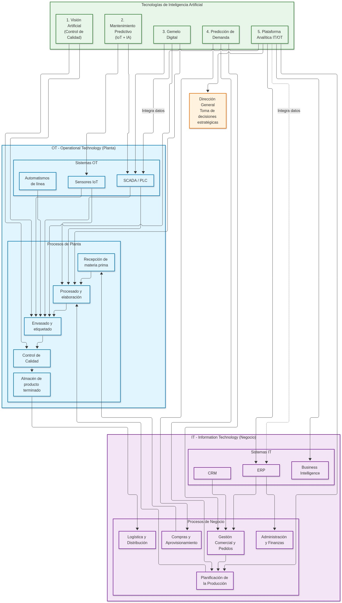
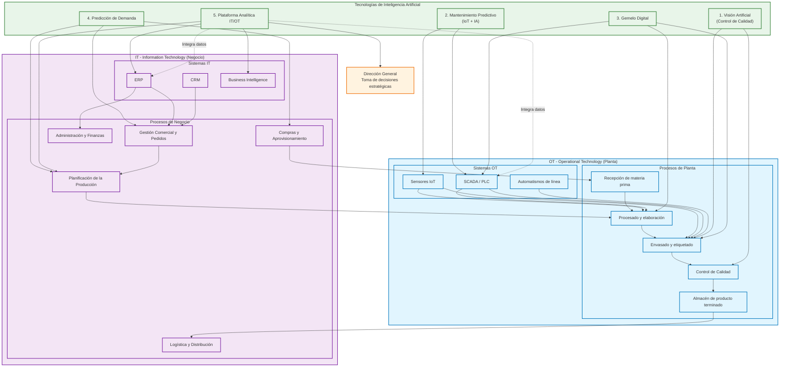

# Diagrama de la Estructura IT / OT e Impacto de la IA

**Empresa:** AgroIndustrial Mediterránea S.L.  
**Alumno:** Marcos Martín Reinón – 1º DAW A  

---

## Captura del diagrama

---

## Código Mermaid utilizado

---

## Explicación del diagrama

### Estructura principal

- **OT (Operational Technology)**: Representa todo lo relacionado con la planta de producción (líneas, sensores, SCADA, control de calidad, etc.).
- **IT (Information Technology)**: Representa los sistemas y procesos de negocio (ERP, comercial, planificación, compras, etc.).
- **Capa de IA**: Muestra las 5 tecnologías propuestas y cómo impactan en los diferentes procesos.

### Impacto de las tecnologías de IA

| Tecnología                        | Afecta principalmente a                          | Resultado esperado                          |
|-----------------------------------|--------------------------------------------------|---------------------------------------------|
| Visión Artificial                 | Control de Calidad y Envasado                    | Menos defectos y mermas                     |
| Mantenimiento Predictivo          | Sensores y SCADA                                 | Menos paradas no planificadas               |
| Gemelo Digital                    | Procesado, Envasado y SCADA                      | Mejor optimización y simulación             |
| Predicción de Demanda             | Planificación, Compras y Comercial               | Mejor ajuste oferta-demanda                 |
| Plataforma Analítica IT/OT        | Integra OT + IT y alimenta a Dirección           | Visibilidad completa y mejores decisiones   |

Este diagrama permite visualizar de forma clara cómo la Inteligencia Artificial actúa como puente entre el mundo de la planta (**OT**) y el mundo del negocio (**IT**).
